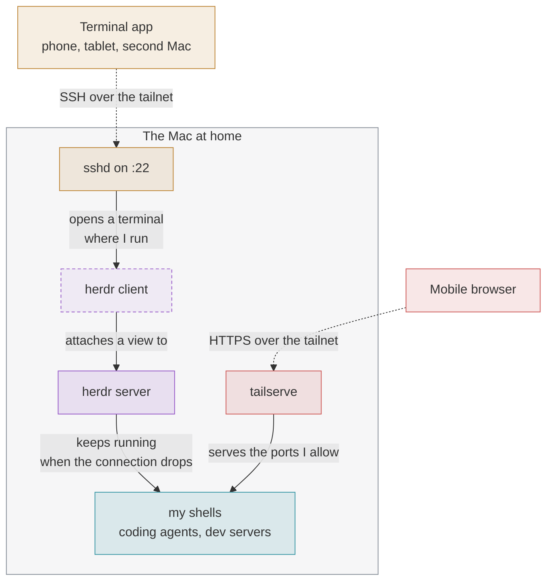

# My Mac lives at home. I code from anywhere.

I'm used to working on a single Mac at my desk, but sometimes I get an idea in the kitchen, or I'm on the bus and I want to know whether the agent answered and what it did. Before, I had to wait until I was back at the desk. Now I grab the phone or the tablet and I'm right where I left off.

The Mac never leaves home. It's the only machine with my whole environment on it, and every other screen just connects to it.

Today I use [Tailscale](https://tailscale.com) to reach the Mac, macOS Remote Login for SSH, [Herdr TUI](https://herdr.dev/tui/) to keep the sessions alive, [tailserve](https://github.com/marcomontalbano/tailserve) to reach my dev servers, and [Moshi](https://getmoshi.app/) on my phone and tablet.

I'll go through the whole setup from zero, mistakes included.

In the diagram below, the dotted arrows are my connections, which come and go. When one drops, the dashed herdr client goes with it, but the server and everything it runs keep going.



## Tailscale, and the package I got wrong

Reaching a Mac at home used to mean port forwarding, fighting with the router, and a home IP that changes whenever it wants. Tailscale skips all of that. Every device joins the same private network and nothing is open to the internet.

On the Mac I installed the app with Homebrew:

```sh
brew install --cask tailscale-app
```

> [!WARNING]
> Use the `tailscale-app` cask, not the `tailscale` formula. They're two different programs. Tailscale [documents three builds for macOS](https://tailscale.com/docs/concepts/macos-variants), and Homebrew has two of them. The formula is the headless daemon meant for servers, the cask is the normal Mac app. Homebrew installs either one without complaining.

Of course I installed the wrong one first. `tailscale` looked like the obvious name. Later I found out there was a real app, installed that too, and ended up with two copies fighting over the tunnel. Which `tailscale` command actually ran depended on my `PATH`. Really painful to figure out weeks later.

The cask is what Tailscale calls the standalone variant. It runs as a system extension, starts at login, sits in the menu bar and updates itself, and you still get the CLI. The formula is for headless servers, with no GUI and no auto-updates, and you set up its background service by hand.

If you already have the formula, remove it and keep the app:

```sh
brew uninstall tailscale
```

On the phone and tablet, get Tailscale from the store and log in with the same account everywhere. A device on a different account ends up on another private network and can't see the others.

To check that every device is there:

```sh
tailscale status
```

```
100.101.10.1  macbook  me@example.com  macOS    -
100.101.10.2  tablet   me@example.com  android  active; direct 203.0.113.7:41641, tx 1533580 rx 853364
100.101.10.3  phone    me@example.com  android  offline, last seen 4d ago
```

The third column is the account. The last one tells you if you can reach the device. A `-` is the machine you're typing on and `offline` means you can't reach it. A live peer shows `active` or `idle`, then `direct` or `relay` depending on how the packets get there.

Each machine also gets a name. From my Android devices the Mac is just `macbook`, and I don't care anymore which IP my home connection has today.

## Why I'm not using Tailscale SSH

My plan was Tailscale SSH. With it, `tailscaled` handles the SSH connection itself, and since the tunnel already knows which device and which user you are, there are no keys to manage. You give access in the tailnet policy file and take it away by removing the device from the admin console.

And the part I wanted most: it only listens inside the tunnel. On café wifi there's simply no port for anyone to find.

Then I tried to turn it on.

```sh
tailscale set --ssh
# The Tailscale SSH server does not run in sandboxed Tailscale GUI builds.
```

At least the error is clear. The GUI app is sandboxed, and a sandboxed process can't open login sessions for other users, which is exactly what an SSH server needs to do. Only the open-source daemon can (yes, the one I had just uninstalled), and going back to it meant losing the GUI and the auto-updates.

So I went with the SSH server macOS already ships. It's just a checkbox in System Settings → General → Sharing → Remote Login. Click the ⓘ next to it and limit *Allow access for* to your user.

There's a catch, though. Remote Login listens on every network interface, and you can see it yourself:

```sh
netstat -an | grep -E '\.22 .*LISTEN'
```

```
tcp4       0      0  *.22                   *.*                    LISTEN
tcp6       0      0  *.22                   *.*                    LISTEN
```

The `*` means any address. So port 22 is open to anyone on the same network as the Mac, café wifi included, and not only to my tailnet. Tailscale SSH would have kept it inside the tunnel.

## The first connection, and the key that replaces the password

Once Remote Login is on, macOS accepts your normal account password. I used it for the very first connection, on purpose, just to see that the network and `sshd` were working before I started with keys.

The first time, the app asks you to trust the Mac's host key fingerprint. That's the Mac proving who it is to you (your key does the opposite). You can't really verify it the first time, so the app remembers it and shouts at you if it ever changes.

Then the key. On the Mac, create the folder and the file with the right permissions:

```sh
mkdir -p ~/.ssh && chmod 700 ~/.ssh
touch ~/.ssh/authorized_keys && chmod 600 ~/.ssh/authorized_keys
```

Don't skip the `chmod`. If anyone else can write to that file, `sshd` ignores it, because whoever can write it could add their own key and log in as you. It doesn't tell you either. The client just goes back to asking for the password.

Now generate the key inside the terminal app on the phone. I picked Ed25519 and named it after the device. The private key stays on the phone. Only the public line (the one starting with `ssh-ed25519 AAAA…`) goes into `~/.ssh/authorized_keys` on the Mac.

Sharing the public key is fine, that's how it's supposed to work. I use one key per device, so if I lose the phone I delete its line and everything else keeps working.

### From a second Mac

It's the same from another Mac. Generate the key on that Mac:

```sh
ssh-keygen -t ed25519 -C "secondary-mac"
```

Put the content of `~/.ssh/id_ed25519.pub` on a new line in `~/.ssh/authorized_keys` on the home Mac, then connect with its Tailscale name. SSH uses the username from the second Mac by default, so write it out if the two are different:

```sh
ssh username@macbook
```

## Turning off passwords

Remember port 22, open on every interface? Until this step, anyone on the same wifi could try to guess my password. Sure, they'd need to actually guess it. But once keys work, there's no reason to keep passwords on.

> [!WARNING]
> Test a key login before doing this. Turn on Remote Login, add your key, log in with it, and only then disable passwords, keeping that session open in another window. Do it the other way around and you're locked out of your own Mac.

I turned them off in a separate config file, which macOS updates leave alone:

```
# /etc/ssh/sshd_config.d/200-local.conf
PasswordAuthentication no
KbdInteractiveAuthentication no
PermitRootLogin no
```

No restart needed, every new connection starts a fresh `sshd`. To see what `sshd` is really using:

```sh
sudo sshd -T | grep -iE 'passwordauthentication|kbdinteractiveauthentication|permitrootlogin'
```

```
permitrootlogin no
passwordauthentication no
kbdinteractiveauthentication no
```

`sshd` keeps the first value it finds for each option, and Apple's own `100-macos.conf` is read before `200-local.conf`. Today Apple's file doesn't touch these three. If an update ever changes that, this command is how you'll find out.

Last check, from another device, without offering a key:

```sh
ssh -o PubkeyAuthentication=no username@macbook
```

```
Permission denied (publickey).
```

No password prompt anymore. `(publickey)` is the list of methods the server accepts, and there's only one left.

Now you can safely connect from a café.

## Keeping the session alive

The first time I closed the app and opened it again, everything was gone. I wasn't logged out. The shell itself didn't exist anymore.

That's just how SSH works. The shell lives inside your connection, and when the connection drops, the processes attached to that terminal get a hangup signal and exit. On a phone that happens all the time, every time the screen locks or the wifi switches to mobile data.

A terminal multiplexer fixes this. It runs a server on the Mac that owns your shells. What you start over SSH is just a client that attaches to it, so the hangup hits the client and not the shells. That's why the multiplexer has to run on the Mac and not on the phone.

[tmux](https://github.com/tmux/tmux) is the one everybody knows, and I started there:

```sh
brew install tmux
tmux new -As main
```

`-s main` names the session and `-A` attaches to it if it already exists, so it's the same command every time you connect. Detach with `Ctrl-b d`. Add `set -g mouse on` to `~/.tmux.conf` if you want to tap between panes.

The problem with tmux is that all panes look the same. With three agents running, you have to go through them one by one to find the one waiting for you. herdr was built for this, and it's what I use now. It recognises the agent in each pane and shows its status in a sidebar.

```sh
brew install herdr
herdr
```

Run `herdr` every time you connect. It starts the session, or attaches to the one already running. I mostly use it with the mouse, so the only shortcut I remember is `Ctrl-b q` to detach. `Ctrl-b ?` shows the rest.

> [!TIP]
> Careful with `herdr server stop`, because it kills every session. The server owns the processes, so any agent still working dies with it. I found out after an upgrade, when I stopped the server and lost a session that was still running. Use `herdr update --handoff` instead, which upgrades without killing your panes.

## What happens when I close the lid

When the Mac goes to sleep, the SSH connection drops, but the herdr session is still there, just frozen. When the Mac wakes up I attach again and carry on. Don't expect to reach it while it's sleeping, though.

To keep it awake I use clamshell mode. With the charger and an external monitor plugged in, I can close the lid and the Mac keeps running. Unplug one of the two and closing the lid puts it to sleep again.

With the lid open, clamshell doesn't apply and the normal idle timer kicks in. Mine was set to one minute. This keeps the Mac awake on the charger without touching the battery settings:

```sh
sudo pmset -c sleep 0
```

If it still falls asleep, the unified log tells you why:

```sh
log show --last 3d --predicate 'eventMessage CONTAINS "Entering Sleep state due to"' --style compact
```

`Idle Sleep` is the timer. `Clamshell Sleep` means the lid was closed with no display attached.

> [!WARNING]
> Don't use `disablesleep`. `sudo pmset -c disablesleep 1` looks like "never sleep on the charger", but the `-c` is ignored and sleep gets disabled everywhere. I had it on for a month without knowing. I noticed when the laptop was still awake in my bag ten hours later. `sudo pmset -a disablesleep 0` undoes it.

## Seeing the dev server on the phone

The dev server listens on `127.0.0.1`, so the phone can't open it. My first idea was ngrok, but that puts your work on the public internet just to solve a problem inside your own network. Tailscale can already do this:

```sh
tailscale serve 3000
```

Use whatever port your dev server runs on. Tailscale makes it available on the tailnet over HTTPS at `https://macbook.tailnet-name.ts.net`, which is your machine name plus your tailnet name. Only your own devices can open it, and `Ctrl-C` stops it.

## Letting tailserve handle the mappings

Tailscale Serve did the job, but the routine got old. A project on 5173, another on 5174, maybe a Storybook on 6006. `npm run dev`, then `tailscale serve 5173`, then grab my phone. Repeat for every project.

Eventually I'd stop everything for the day and forget to clean up. The next morning I'd find a bunch of stale entries pointing to ports where nothing was running anymore.

Don't get me wrong, I love Tailscale Serve. I often work remotely, sometimes from public networks, and being able to open my local dev servers from another device without exposing them to the internet is something I really appreciate. I was just tired of managing the mappings myself.

So I wrote [tailserve](https://github.com/marcomontalbano/tailserve). Start a dev server and it shows up on your tailnet. Stop it and the mapping disappears. That's it.

On the Mac, install it with Homebrew:

```sh
brew install marcomontalbano/tap/tailserve
```

Start your dev server as usual, then pick what to serve:

```sh
tailserve allow
tailserve start
```

`tailserve allow` asks which of the running servers to serve, and how to match each one: a port, a process name like `node`, or both. `tailserve start` then looks at what's listening every two seconds and serves the ones you allowed.

It prints the address of a dashboard, something like `https://macbook.tailnet-name.ts.net/`. Open it from your phone and every server you allowed is one tap away, grouped by repository.

Nothing is served until you allow it, and everything it serves lives in its own Tailscale session, so stopping tailserve (or a crash) takes it all offline. And it never touches mappings you made yourself with `tailscale serve`; it only shows them.

## Picking the app on the phone

I started with [Termius](https://termius.com), because it's the app everybody suggests, and I built everything above with it.

Then I found Moshi. It's made for running coding agents from a phone, and a couple of things convinced me. It sends me a notification when an agent has an answer. It has a diff viewer, so I can see what the agent changed before replying.

And it understands herdr. It doesn't just show herdr's terminal screen: the sidebar shows its workspaces and tabs too, and when I open the app everything is where I left it.

Most of this needs a small daemon on the Mac. It runs as a background service and comes from a third-party tap you have to trust explicitly, so think about it before installing:

```sh
brew tap rjyo/moshi
brew trust --formula rjyo/moshi/moshi-hook
brew install moshi-hook
brew services start moshi-hook
```

Moving from Termius to Moshi showed me what really matters here, and it's the server side: Tailscale, `sshd`, one key per device and the multiplexer. The app is a window you can swap whenever you want. I created a new key in Moshi, added one line to `authorized_keys`, and my herdr session didn't notice anything.

## Free to leave the desk

These days I leave the desk more often, because nothing keeps me there. When an agent has an answer my phone tells me, and I can continue the same session from wherever I am, or leave it for later.

It has its limits. Heavy UI work on a phone screen is still a bad idea, and if home loses power I lose my dev box. But for reading code, running things, fixing something small, and babysitting anything long-running, a tablet and a herdr session are all I need.

On a second Mac, the screen stops being a limit. Same terminal, same herdr session, the dev server in the browser through tailserve. It feels like sitting at the desk.

### What's next?

Right now I'm testing two apps that might replace part of this setup. It's early, so take this as a first impression.

The first is [Herdr App](https://herdr.dev/), from the herdr team. Your agents run in herdr-core, a small server on your machine, and the app shows them in a sidebar with their status (working, done, or waiting for you). You can add any machine you reach over SSH, so you can install it on a second Mac and connect straight to the Mac at home. The Android app does the same from the phone. If it holds up, it could replace both the herdr TUI and Moshi for me. One thing to know: it's a separate program, so agents you start in the TUI don't show up in the app.

The second is [Rex](https://www.superlogical.com/), by Superlogical. It's a terminal with its own server that keeps sessions alive, and the Mac app can connect to Rex servers on your other machines. It's in public beta, macOS only for now, and the iOS client is still in development.

Whichever one I end up with, Tailscale, SSH and the keys stay exactly as they are.
